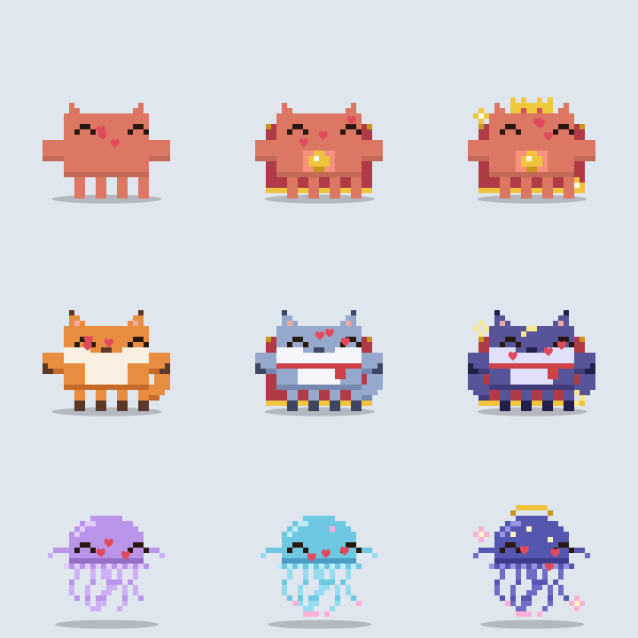
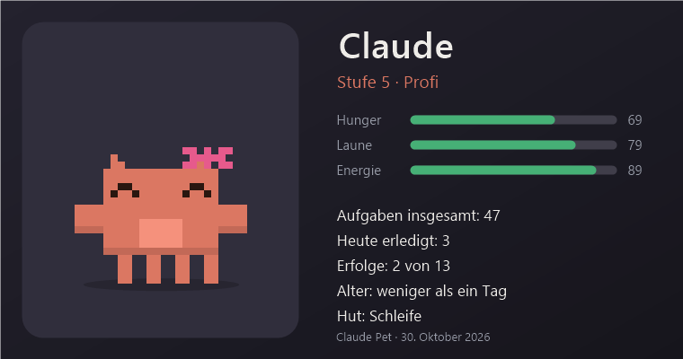
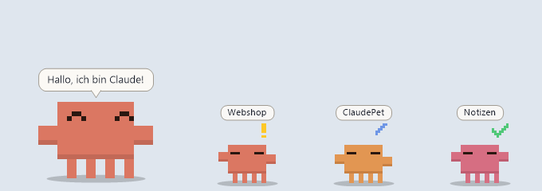

# Claude Pet

A tiny pixel pet for the Windows desktop that shows the status of your [Claude Code](https://claude.com/claude-code) sessions: working, needs you, done, error.

> Unofficial hobby project. Not affiliated with or endorsed by Anthropic. "Claude" and "Claude Code" are trademarks of Anthropic.
> The pet's menus and speech bubbles are in German.



## Features

- **Claude Code status** per session, with a small icon for what Claude is doing (reading, writing, searching, running a command). Several sessions get a mini pet each, one color per project. Click to bring the session's window to the front.
- **Context gauge** on the pet's belly, plus a warning when a session is almost full.
- **Lives on your desktop:** walks, sits on window edges, jumps between windows and monitors, sleeps, gets hungry.
- **Grows up:** levels, three forms per character (at level 10 and 20), hats, fur colors, achievements, diary, daily recap.
- **Three characters:** Claude, Fox, Jellyfish.
- **Small helpers:** break and 20-20-20 eye reminders, custom reminders, battery warning, dances when music plays, hides during fullscreen.

 

## Install

Requires Windows 10/11 (PowerShell 5.1 and .NET Framework 4 are built in).

1. Download `ClaudePet.exe` from **Releases**, or clone this repo and run `Claude-Pet-bauen.ps1` to build it yourself.
   The release is unsigned, so SmartScreen may warn ("More info", then "Run anyway"). Compare `Get-FileHash .\ClaudePet.exe` with the SHA-256 in the release notes.
2. Start `ClaudePet.exe` (from a clone: `Claude Pet starten.bat`). Right-click the pet for the menu. Hide/show: `Win` + `Alt` + `P`.
3. Optional, for Claude Code status: run `ClaudeStatus-Setup.ps1`. It adds hooks to `%USERPROFILE%\.claude\settings.json` (a backup is made first) and takes effect in new sessions.

```powershell
powershell -ExecutionPolicy Bypass -File ClaudeStatus-Setup.ps1            # install hooks
powershell -ExecutionPolicy Bypass -File ClaudeStatus-Setup.ps1 -Remove    # remove them
```

Menu → Settings → "Verbindung prüfen..." checks the whole setup and can repair missing hooks.

## Privacy

No network code. Everything stays on your PC (`%APPDATA%\ClaudePet`). The pet reads:

- status files written by the hooks (project folder, tool type, file name or first word of a command)
- token counts from the latest reply in Claude's own session file, never the conversation (context gauge)
- time of the last mouse/keyboard input, never what you type (eye break)
- the speaker output level, nothing is recorded (dance)
- window rectangles (to stand on window edges)

The context gauge, eye break and dance can each be switched off in the menu.

## Build and modify

The source is in `src\` (C# 5, one partial class `PetForm`); all graphics are drawn in code from pixel grids. Run `Claude-Pet-bauen.ps1` after changes. Save source files as UTF-8 **with BOM**.

## Credits

Created by Semiexe. Developed with AI assistance.

## License

[MIT](LICENSE)
